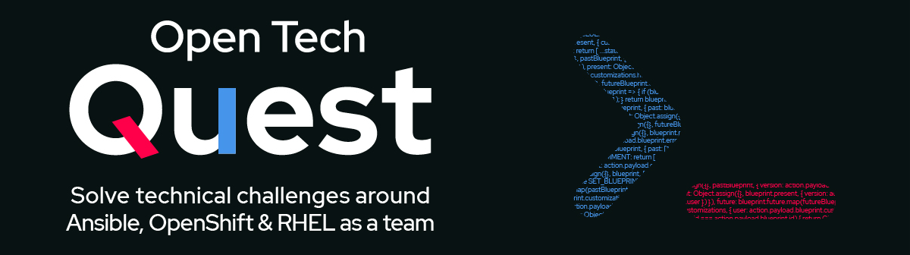

# Red Hat Summit Connect - Open Tech Quest - OpenShift (Python + MariaDB)



Same look as `openshift-nginx-demo-app`, but the **challenge flag is read from a MariaDB database**
by a small Python (Flask + gunicorn) application.

| Component | Image |
|-----------|-------|
| App (build)   | `registry.access.redhat.com/hi/python:latest-builder` |
| App (runtime) | `registry.access.redhat.com/hi/python:latest` → `quay.io/open-tech-quest/openshift-python-mariadb-app` |
| Database      | `registry.access.redhat.com/hi/mariadb:latest` (used as-is, no custom image) |

```
Helm chart (chart/otq-python-mariadb)                    External MariaDB (or demo-db-deployment/)
Route (edge TLS) ─▶ Service ─▶ app (gunicorn :8080) ──SELECT flag──▶ database.host:database.port
```

The Helm chart only deploys the app. The database is hosted externally; the connection is configured
via the `database.*` values. For demos, [demo-db-deployment/](demo-db-deployment/) deploys a MariaDB with Kustomize.

## Repository layout

```
app/                         Python application
  otq/__init__.py            Flask app: /, /healthz, /readyz
  otq/templates/index.html   Page (copied from the nginx demo app)
  otq/static/                Bootstrap, CSS, banner, favicon
Containerfile                Multi-stage build (hi/python builder -> hi/python runtime)
build.sh                     Multi-arch build + push (linux/amd64, linux/arm64)
chart/otq-python-mariadb/    Helm chart for OpenShift (app only)
demo-db-deployment/          Kustomize: demo MariaDB (Deployment, Service, PVC, Secret)
  secret.env                 Passwords + challenge flag (change before deploying!)
  initdb/10-schema.sql       Database layout
  initdb/20-seed-challenge.sh Inserts the challenge flag from the Secret
```

## Database layout

Database `otq`, user `otq` (only `SELECT` is needed by the app, the entrypoint grants all on `otq`).

**Table `challenge`**

| Column       | Type           | Constraints                     | Description |
|--------------|----------------|---------------------------------|-------------|
| `id`         | `INT UNSIGNED` | PK, `AUTO_INCREMENT`            | |
| `name`       | `VARCHAR(64)`  | `NOT NULL`, `UNIQUE`            | Challenge identifier; the app selects the row via `CHALLENGE_NAME` |
| `flag`       | `VARCHAR(128)` | `NOT NULL`                      | Flag shown on the page |
| `created_at` | `TIMESTAMP`    | default `CURRENT_TIMESTAMP`     | |
| `updated_at` | `TIMESTAMP`    | `ON UPDATE CURRENT_TIMESTAMP`   | |

DDL: [demo-db-deployment/initdb/10-schema.sql](demo-db-deployment/initdb/10-schema.sql)

The app runs:

```sql
SELECT flag FROM challenge WHERE name = %s;
```

### How the flag gets into the database

**External database:** create the table with the DDL above and insert the row yourself:

```sql
INSERT INTO challenge (name, flag) VALUES ('openshift-python-mariadb', '<flag>');
```

**Demo database ([demo-db-deployment/](demo-db-deployment/)):**

1. Passwords and flag come from [demo-db-deployment/secret.env](demo-db-deployment/secret.env), which
   Kustomize turns into the Secret `otq-mariadb`.
2. The scripts in `initdb/` are mounted to `/docker-entrypoint-initdb.d` of the MariaDB container.
   The MariaDB entrypoint runs them **when the data directory is empty** (first start on a fresh PVC).

> Changing `challenge-flag` later does not update an already initialized PVC. Update the row manually
> or delete the PVC:
> `oc exec deploy/otq-mariadb -- sh -c 'MYSQL_PWD=$MARIADB_PASSWORD mariadb -u otq otq -e "UPDATE challenge SET flag=\"NEW\" WHERE name=\"openshift-python-mariadb\""'`

## Build the multi-arch image (Podman Desktop on Mac)

```shell
podman login quay.io
./build.sh
```

Builds `linux/amd64` and `linux/arm64` into one manifest and pushes
`quay.io/open-tech-quest/openshift-python-mariadb-app:<YYYYMMDDHHMM>` and `:latest`.

Environment overrides: `REPOSITORY`, `VERSION`, `PLATFORMS`, `PUSH=false` (build only).

## Run locally with Podman

```shell
REPOSITORY=localhost/otq-app VERSION=dev PUSH=false ./build.sh

podman pod create --name otq -p 8080:8080
podman run -d --pod otq --name otq-db \
  -e MARIADB_ROOT_PASSWORD=rootpw -e MARIADB_DATABASE=otq \
  -e MARIADB_USER=otq -e MARIADB_PASSWORD=apppw \
  -e CHALLENGE_NAME=openshift-python-mariadb -e CHALLENGE_FLAG=LocalTestFlag123 \
  -v ./demo-db-deployment/initdb:/docker-entrypoint-initdb.d:ro,Z \
  registry.access.redhat.com/hi/mariadb:latest
podman run -d --pod otq --name otq-app -e DB_HOST=127.0.0.1 -e DB_PASSWORD=apppw localhost/otq-app:dev

open http://localhost:8080
podman pod rm -f otq
```

## Deploy on OpenShift

### 1. Database (demo only)

Skip this if you use an external database. Otherwise edit
[demo-db-deployment/secret.env](demo-db-deployment/secret.env) first, then:

```shell
oc new-project otq-demo
oc apply -k demo-db-deployment/
```

### 2. App with Helm

Against the demo database (reuses its Secret):

```shell
helm install demo chart/otq-python-mariadb \
  --set database.host=otq-mariadb \
  --set database.existingSecret=otq-mariadb
```

Against an external database:

```shell
helm install demo chart/otq-python-mariadb \
  --set database.host=mariadb.example.com \
  --set database.password='<password>'
```

Show URL:

```shell
echo "https://$(oc get route demo-otq-python-mariadb-app -o jsonpath='{.spec.host}')"
```

Important values (see [values.yaml](chart/otq-python-mariadb/values.yaml)):

| Value | Default | |
|-------|---------|-|
| `database.host` | `""` (required) | MariaDB host / Service name |
| `database.port` | `3306` | |
| `database.name` / `database.user` | `otq` / `otq` | |
| `database.password` | `""` | Stored in Secret `<release>-otq-python-mariadb`; required unless `existingSecret` is set |
| `database.existingSecret` / `existingSecretPasswordKey` | `""` / `database-password` | Use an existing Secret for the password |
| `database.connectTimeout` | `3` | Seconds |
| `challenge.name` | `openshift-python-mariadb` | Row the app displays |
| `app.image.repository` / `tag` | `quay.io/open-tech-quest/openshift-python-mariadb-app` / `latest` | |
| `route.enabled` / `route.host` | `true` / generated | Edge TLS |

All pods run under the default `restricted-v2` SCC (random UID, no privilege escalation, all capabilities dropped).

## App configuration (environment)

| Variable | Default |
|----------|---------|
| `DB_HOST` / `DB_PORT` | `localhost` / `3306` |
| `DB_NAME` / `DB_USER` / `DB_PASSWORD` | `otq` / `otq` / `""` |
| `DB_CONNECT_TIMEOUT` | `3` |
| `CHALLENGE_NAME` | `openshift-python-mariadb` |
| `PORT` | `8080` |
| `GUNICORN_WORKERS` / `GUNICORN_THREADS` | `2` / `4` |

Endpoints: `/` (page, HTTP 503 with an error box if the DB is unavailable), `/healthz` (liveness), `/readyz` (checks DB).
